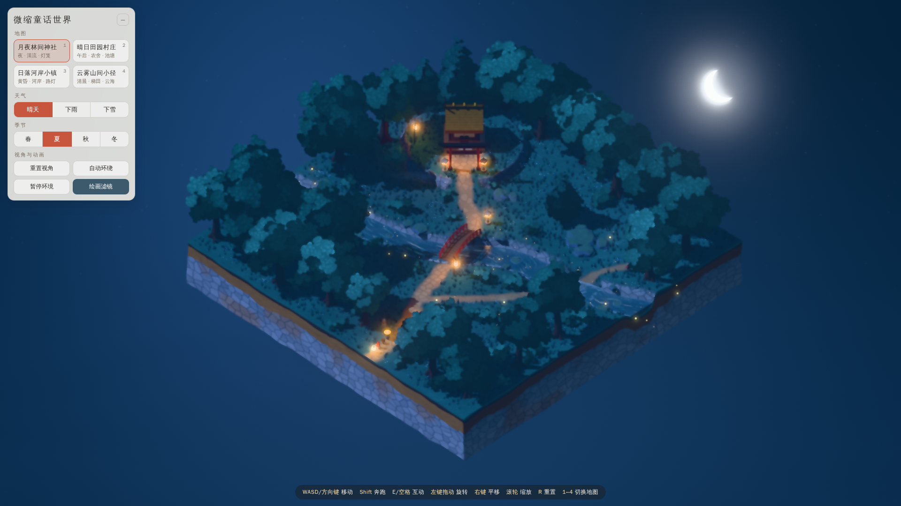

# 微缩童话世界（Three.js）

桌面上的一座精致小世界：四张可切换的程序化微缩地块，悬浮在简洁的背景中。可以操控小旅人带着三位伙伴四处走动，拉近观察细节，也可以切换晴天、下雨、下雪与春夏秋冬。



## 启动

需要 Node.js 18+（开发与验证使用 Node 22）。

```bash
npm install
```

开发模式（热更新）：

```bash
npm run dev
```

打开 <http://127.0.0.1:5173/>。

构建并本地预览（与交付截图一致的方式）：

```bash
npm start
```

打开 <http://127.0.0.1:4173/>。

运行时不依赖任何远程 CDN：three.js 由 Vite 打包，纹理全部在运行时用 Canvas 和着色器生成。依赖版本由 `package.json` 与 `package-lock.json` 锁定（three 0.186.1、vite 7.3.7）。

URL 参数：`?map=0`～`?map=3` 指定初始地图；`?manual` 为手动步进模式，仅供自动化截图与验证使用。

## 操作

| 操作 | 说明 |
| --- | --- |
| WASD / 方向键 | 移动（相对屏幕方向），角色朝向与移动方向一致 |
| Shift | 奔跑 |
| E / 空格 | 互动：角色身边光点飞散；靠近灯笼时灯火闪亮；靠近水面时荡开涟漪 |
| 左键拖动 | 旋转视角（方位角 + 仰角） |
| 右键拖动 / Shift + 拖动 | 平移视角 |
| 滚轮 / 双指 | 缩放；放得越大，镜头越紧跟角色 |
| R | 重置视角 |
| P / O | 暂停环境动画 / 自动环绕 |
| 1–4 | 切换地图 |

左上角面板：地图、天气（晴天 / 下雨 / 下雪）、季节（春 / 夏 / 秋 / 冬）、重置视角、自动环绕、暂停环境、绘画滤镜开关。面板可收起；在 1366×768 下所有控件都能完整显示和点击。

## 四张地图

| 地图 | 默认环境 | 主要内容 |
| --- | --- | --- |
| 月夜林间神社 | 夜晚 · 晴 · 夏 | 冷蓝青绿的林间，暖黄灯笼是视觉焦点；弯曲铺石小径、穿过地图的溪流、朱红拱桥与浅滩踏石、红色鸟居、茅草本殿与石砌高台、茂密树林、溪岸岩石、萤火虫与溪面低雾 |
| 晴日田园村庄 | 午后 · 晴 · 春 | 茅草农舍、门廊小屋、带老虎窗的蓝色小屋、三层钟楼客栈（地标），S 形土路与支路、小池塘、菜圃与栅栏、水井、樱花树、炊烟 |
| 日落河岸小镇 | 日落 · 晴 · 夏 | 台地上一排沿岸房屋、河岸铺石步道、木推车摊位、6 盏路灯与悬垂灯串、木栈桥与小船；前景大面积河面，有流动笔触高光、泡沫、灯光倒影，地块前缘可见河水横截面 |
| 云雾山间小径 | 清晨 · 晴 · 夏 | 悬浮山岛，6 层石砌梯田、盘山道、切穿岛缘的峡谷与木板吊桥、山顶凉亭，云雾在地形间缓慢漂移，背景为云海 |

四张地图轮廓不同（方形、两种长方形、不规则浮岛），道路布局与镜头构图也不同，但共享同一套材质、植被、建筑与角色资产。切换地图后会恢复该地图的默认天气、季节和镜头构图，角色在该地图的出生点出现。

## 环境动态

- **植被**：草丛、花朵、树冠在顶点着色器中随风摆动，相位取自世界坐标与实例序号，彼此不同步。
- **水面**：沿流向移动的三层笔触高光（带闪烁）、岸线与岩石周围的泡沫、随视角变化的闪光、天空反射、雨天涟漪、角色涉水与互动涟漪、路灯倒影。水面是真实的三维透明网格，会接收树木和建筑的阴影。
- **烟与雾**：烟囱炊烟为 GPU 粒子；云雾为实例化面片，贴近地面处和角色附近会自动变淡，保证角色和道路可辨认。
- **粒子**：夜间萤火虫、春季花瓣、秋季落叶、互动光点。
- **角色**：腿和手臂摆动、身体起伏、平滑转向、减速停步；伙伴沿足迹跟随，停下后转向玩家；灯笼精灵悬浮摆动，夜里自带暖光。
- **天气**
  - 雨：雨丝按速度方向拉长，近处更长更亮，远处更短更淡；地面有溅落环；光照变暗、雾变浓、色彩降饱和，地表与植被变湿变暗，水面涟漪增多，灯光与窗光增强。
  - 雪：雪花大小随深度变化；积雪随时间覆盖地表、屋顶、树冠和岩石，停雪后缓慢融化。
- **季节**：联动树叶颜色、冬季落叶（露出枝干）、地表草色与枯草斑块、花朵数量与颜色、草丛颜色、冬季积雪、花瓣或落叶飘落，以及光照色温。

## 技术实现

```
src/
  main.js            渲染器、灯光、主循环、环境插值、互动、地图加载与释放
  ui.js / style.css  中文控件
  core/
    materials.js     共享风格化材质（Lambert + onBeforeCompile 注入）
    glsl.js          噪声、Voronoi、风格化明暗分区光照
    textures.js      Canvas 程序化纹理：建筑图集、叶簇、柔光点
    geo.js           GeoBuilder：带顶点色/图集坐标/世界尺度 UV 的几何合并
    camera.js        正交斜俯视相机：自动取景、跟随、旋转/缩放/平移/环绕
    post.js          后期：泛光 → Kuwahara 绘画滤镜 + 调色 → 天气叠加层
    rng.js           固定种子随机数、值噪声、样条
  world/
    world.js         高度场、地形网格与岩土剖面、可通行网格、碰撞、灯、释放
    water.js         水面着色器、高度/流向 DataTexture、水体横截面
    vegetation.js    树冠卡片、树干、草丛、花朵、岩石（全部实例化）
    props.js         房屋、神社、鸟居、灯笼、桥、栅栏、摊位、路灯、灯串等
    characters.js    旅人与三名伙伴、步态、足迹跟随
    effects.js       萤火虫、烟、云雾、落叶、互动光点
    weather.js       雨、溅落、雪
    env.js           默认环境 + 天气/季节叠加与平滑过渡、背景着色器
    palette.js       季节调色板
  maps/              四张地图的地形、布局、默认环境与镜头
tools/               截图、验证、报告生成脚本
```

**渲染管线**：多重采样 HalfFloat 渲染，接 UnrealBloom（只让灯泡、月亮等高亮部分泛光），再接八扇区广义 Kuwahara 绘画滤镜，同时做调色、暗角和纸纹，然后叠加天气层，最后做 Neutral 色调映射输出。雨丝和雪花在绘画滤镜之后绘制，避免细线被抹平。

**风格化材质**：在 Lambert 光照上注入柔和的明暗两分区、世界空间笔触噪声、积雪、湿润、风动和图集采样。地形着色器负责草地笔触、程序化花点、Voronoi 铺石小路，陡坡自动显示石墙纹理。剖面依次为草皮唇边、深色表土、赭黄土层和石块层。

**模型**：
- 树冠由面向相机的叶簇卡片组成（球面法线、扇贝状叶团贴图、受光边缘高光），配有自定义深度材质来投射阴影。
- 建筑由盒体、柱体和双坡/四坡屋顶在 CPU 端组合，带屋檐、窗框、玻璃、窗棂、窗台、门、台阶、烟囱、老虎窗、门廊；按材质合并为 3 个网格。
- 地形是程序化高度场（河道/小路折线距离场、梯田量化、切填坡道、峡谷切割），环境遮蔽烘焙进顶点色。

**探索**：
- 可通行网格分辨率 0.25，综合考虑地块边缘、水深、坡度和碰撞体。桥、栈桥、凉亭是覆盖高度的可行走平台。
- 移动时先尝试完整位移，再尝试沿单轴滑动；单帧高差超过阈值则拒绝移动，因此角色不会翻越挡墙或跌出地块。

**性能**：
- 草丛（2600–4200）、花朵、岩石、树冠和树干都用 InstancedMesh。
- 材质全局共享，切换地图不会重新编译着色器。
- 粒子数量有固定上限，并全部由 GPU 驱动。
- 像素比上限为 1.5。

**可复现与资源管理**：
- 每张地图使用固定种子（101/202/303/404），噪声为确定性哈希。
- 事件监听只在启动时注册一次；切换地图时释放旧地图的非共享几何、材质和 DataTexture。

## 验证

```bash
npm run build
npm run preview
npm run verify
npm run shots
npm run report
```

后三条命令需要在 preview 运行时另开终端执行。`verify` 与 `shots` 需要本机可用的 Playwright + Chromium，没有写入依赖。`verify` 输出 `verification/verify_result.json`，`shots` 重新生成截图，`report` 根据实测结果生成 `scene_report.json`。

验证脚本在真实页面里通过固定步长推进主循环，覆盖以下内容：

- 四张地图沿路线自动行走（神社 8/8、村庄 6/6、河岸 9/9、山道 30/30 个航点全部到达，包括拱桥、浅滩、栈桥和峡谷吊桥）。
- 撞向房屋、深水、地块边缘、梯田挡墙时不会穿入，也不会掉出地块。
- 伙伴跟随距离，以及玩家停下后伙伴也随之停下。
- 真实鼠标拖动和滚轮操作相机，R 键重置，自动环绕。
- 暂停时环境时间冻结、角色仍可移动；恢复后无跳变。
- 靠近灯笼时灯光增强，E 键闪光，水边涟漪。
- 通过按钮切换雨、雪、晴：太阳变暗、积雪随时间累积、停雪后融化。
- 四季切换时地表颜色、叶量、落叶和积雪的变化。
- 三轮地图切换后几何/纹理数量和场景子节点数量保持稳定，且没有新增事件监听。
- 1366×768 下控件全部可见、可点击。
- 控制台无错误。

## 截图

`screenshots/` 中所有截图均来自真实运行的页面：

- 01–04：四张地图的默认全景（1920×1080）
- 05–06：雨天（河岸全景、神社近景）
- 07–08：雪天（村庄、神社）
- 09–10：秋季（村庄、山岛）
- 11–12：冬季（山岛、村庄）
- 13–17：近景细节（神社拱桥、鸟居与本殿、村庄、河岸步道、峡谷吊桥）
- 18：互动光点
- 19：1366×768 下的界面

## 素材来源

所有几何、纹理、着色器、调色与布局都由本项目代码程序化生成：Canvas 绘制的图集与叶簇，加上着色器噪声。没有使用外部模型、图片、贴图或生成式图像。参考视频与截图只用于观察美术气质与构图，没有作为背景、贴图或播放内容使用。界面字体使用系统字体（中文回退到文泉驿正黑等）。

## 已知不足

- 验证环境只有 SwiftShader 软件渲染，没有 GPU，因此缺少真实显卡下的帧率数据。软件渲染下 1920×1080 单帧约需数百毫秒；交互流畅度需要在有显卡的机器上确认。
- 绘画滤镜（每像素 24 次采样 × 8 扇区）在高分屏或集成显卡上开销较大，可以在面板中关闭。
- 雨丝和雪花绘制在叠加层，只在地形以下裁剪，不会被建筑或树冠遮挡。
- 云雾是面片，与陡峭岩壁相交处仍可能有轻微硬边。
- 伙伴只沿足迹跟随，彼此不避让；急转弯时可能短暂贴近。
- 角色和道具为简单几何造型，没有骨骼动画和音效。
- 背景渐变与云海在屏幕空间绘制，旋转视角时没有透视变化。
- 季节切换时树冠颜色即时切换，地表颜色则有 0.9 秒渐变。
- 移动端只有基础的触控旋转和缩放，没有虚拟摇杆。
